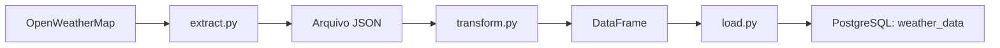

# 🌦️ Pipeline ETL de Dados Meteorológicos

Pipeline em Python que consulta as condições meteorológicas atuais de Recife na API OpenWeatherMap, salva a resposta em JSON, transforma os dados em um DataFrame e os carrega no PostgreSQL. O projeto demonstra integração com API REST, transformação de dados e persistência com controle de duplicidade.

## 🏗️ Arquitetura de Dados Meteorológicos em Nuvem


A figura apresenta o ambiente em nuvem, com Oracle Cloud, orquestração pelo Apache Airflow e persistência no PostgreSQL. As instruções deste README cobrem a execução local do ETL; os arquivos de implantação e a DAG do Airflow não estão presentes nesta cópia do repositório.

## ✨ Funcionamento

1. **Extração:** consulta o endpoint `https://api.openweathermap.org/data/2.5/weather`, com país `BR`, unidades métricas e descrições em português. A requisição tem timeout de 30 segundos e verifica erros HTTP.
2. **Transformação:** lê o JSON e seleciona 12 campos, convertendo o timestamp Unix para uma data com fuso UTC.
3. **Carga:** grava o DataFrame em uma tabela temporária e insere os registros na tabela `weather_data`, dentro de uma transação.

A carga elimina repetições de `(city_id, timestamp)` na tabela temporária e utiliza `ON CONFLICT (city_id, timestamp) DO NOTHING` para ignorar observações já armazenadas. Registros existentes não são atualizados.



O módulo `pipeline.py` executa as três etapas em sequência. A cidade padrão é Recife; a função `extract_weather_data(city)` aceita outra cidade brasileira, mas o pipeline não oferece argumento de linha de comando para essa escolha.

## 🛠️ Tecnologias

| Tecnologia | Uso no projeto |
| --- | --- |
| Python | Implementação do pipeline; requisito declarado `>=3.12` |
| requests | Requisição HTTP à OpenWeatherMap |
| pandas | Transformação do JSON e escrita do DataFrame via `to_sql` |
| SQLAlchemy | Conexão, transações e execução de SQL |
| psycopg2-binary | Driver de conexão com PostgreSQL |
| python-dotenv | Leitura das configurações do arquivo `.env` |
| uv / uv_build | Gerenciamento do ambiente, lockfile e empacotamento |

`cryptography` também é uma dependência direta declarada no `pyproject.toml`, embora os módulos do projeto não a importem diretamente. Os requisitos estão no [pyproject.toml](pyproject.toml), e as versões resolvidas estão no [uv.lock](uv.lock).

## 📁 Estrutura

```text
engenharia-dados/
├── src/
│   ├── __init__.py
│   └── engenharia_dados/
│       ├── __init__.py          # Função do comando engenharia-dados
│       ├── config.py            # Ambiente e URL da API
│       ├── extract.py           # API → JSON
│       ├── transform.py         # JSON → DataFrame
│       ├── load.py              # DataFrame → PostgreSQL
│       ├── pipeline.py          # Execução completa do ETL
│       └── test_connection.py   # Diagnóstico de conexão com o banco
├── .env.example
├── .gitignore
├── .python-version
├── pyproject.toml
├── uv.lock
└── README.md
```

A pasta `data/` é criada automaticamente pela extração quando necessário. Ela é ignorada pelo Git, assim como `.env` e `.venv/`; o JSON local não acompanha um clone do repositório.

## 📋 Pré-requisitos

- **uv**, instalado conforme a [documentação oficial](https://docs.astral.sh/uv/getting-started/installation/), ou **pip** para a instalação alternativa.
- **Python 3.12**, versão selecionada pelo arquivo `.python-version`. O requisito de empacotamento permite Python `>=3.12`.
- Acesso à internet e uma chave válida da **OpenWeatherMap** para a extração.
- Um servidor **PostgreSQL**, banco e tabela de destino previamente preparados para a carga.

### Preparação do PostgreSQL

O código não cria o banco nem a tabela definitiva. Antes da carga, disponibilize uma tabela `weather_data`, acessível sem qualificação de schema pela conexão, com as colunas descritas em “Dados produzidos”.

A tabela deve ter uma restrição ou índice único compatível com `ON CONFLICT (city_id, timestamp)`. Os tipos devem aceitar os dados correspondentes, incluindo o timestamp em UTC. O usuário configurado precisa de permissões para criar tabelas temporárias e inserir dados na tabela de destino.

**O repositório não inclui DDL ou migrações para provisionar essa estrutura.** A preparação do schema é uma etapa externa necessária antes de executar a carga ou o pipeline completo.

## 📦 Instalação

### Com uv

Após obter o repositório, abra um terminal na pasta que contém `pyproject.toml`. Confirme a instalação do uv:

```bash
uv --version
```

Prepare o ambiente com as dependências bloqueadas:

```bash
uv sync --locked
```

Esse comando cria ou sincroniza `.venv` e instala o projeto com suas dependências. O [lockfile](uv.lock) registra as versões resolvidas; `--locked` impede sua atualização durante a preparação e sinaliza uma divergência em relação ao `pyproject.toml`. Não é necessário executar `uv lock` para instalar o ambiente existente. Atualizar dependências é uma operação separada da reprodução desse ambiente, conforme a [documentação do uv](https://docs.astral.sh/uv/concepts/projects/sync/).

Valide a importação dos módulos sem consultar a API nem o banco:

```bash
uv run --locked python -c "import engenharia_dados.pipeline; print('Importacao OK')"
```

Os comandos com `uv run` utilizam o ambiente do projeto; a ativação manual de `.venv` é desnecessária. Execute os comandos abaixo na raiz do repositório para que os caminhos relativos de dados sejam resolvidos como documentado.

### Alternativa com pip

O projeto também pode ser instalado diretamente pelo `pyproject.toml`. Com Python 3.12 disponível, abra o terminal na raiz do repositório e crie um ambiente virtual:

```bash
python -m venv .venv
```

Ative o ambiente conforme o terminal utilizado.

**Windows PowerShell:**

```powershell
.\.venv\Scripts\Activate.ps1
```

**Windows Prompt de Comando:**

```cmd
.venv\Scripts\activate.bat
```

**Linux/macOS (Bash):**

```bash
source .venv/bin/activate
```

Com o ambiente ativado, instale o projeto em modo editável e suas dependências:

```bash
python -m pip install -e .
python -c "import engenharia_dados.pipeline; print('Importacao OK')"
```

A instalação editável mantém o pacote associado ao código em `src/`. O pip utiliza os requisitos do `pyproject.toml` e instala o backend de build declarado, mas não utiliza o `uv.lock`; as versões resolvidas podem diferir das instaladas com uv.

Depois, siga a configuração abaixo. Para executar com pip, mantenha o ambiente ativado e substitua `uv run --locked python` por `python` nos comandos deste README. Por exemplo:

```bash
python -m engenharia_dados.test_connection
python -m engenharia_dados.pipeline
```

O diagnóstico exige a configuração do banco; o pipeline completo também exige a chave da API e a tabela de destino preparada.

## ⚙️ Configuração

Crie `.env` na raiz a partir do exemplo existente.

**Windows PowerShell:**

```powershell
Copy-Item .env.example .env
```

**Shell Bash:**

```bash
cp .env.example .env
```

Edite o arquivo com suas configurações. O `.env.example` contém apenas a chave da API; acrescente as variáveis do PostgreSQL para executar a carga.

```dotenv
OPENWEATHER_API_KEY=
POSTGRES_USER=
POSTGRES_PASSWORD=
POSTGRES_HOST=
POSTGRES_PORT=
POSTGRES_DB=
```

| Variável | Finalidade | Obrigatoriedade |
| --- | --- | --- |
| `OPENWEATHER_API_KEY` | Autenticação na OpenWeatherMap | Extração |
| `POSTGRES_USER` | Usuário do banco | Carga e diagnóstico de conexão |
| `POSTGRES_PASSWORD` | Senha do banco | Carga e diagnóstico de conexão |
| `POSTGRES_HOST` | Endereço do servidor | Carga e diagnóstico de conexão |
| `POSTGRES_PORT` | Porta do servidor, em formato inteiro | Carga e diagnóstico de conexão |
| `POSTGRES_DB` | Nome do banco de destino | Carga e diagnóstico de conexão |
| `WEATHER_DATA_PATH` | Caminho do JSON usado na extração e transformação | Opcional; padrão `data/weather_data.json` |

Preencha os valores obrigatórios antes de executar a etapa correspondente. As configurações também podem ser fornecidas pelo ambiente do processo; valores já definidos nele têm precedência sobre o `.env`. O arquivo `.env` é localizado a partir de `config.py`, na raiz do projeto. Não publique credenciais.

## ▶️ Execução

### Verificar a conexão com PostgreSQL

```bash
uv run --locked python -m engenharia_dados.test_connection
```

Executa `SELECT current_database(), version()` e imprime o nome do banco e a versão do PostgreSQL. Esse diagnóstico exige as variáveis do banco, mas não a chave da API nem a tabela `weather_data`.

### Executar o pipeline completo

Depois de configurar a chave da API, o banco e a tabela de destino:

```bash
uv run --locked python -m engenharia_dados.pipeline
```

O pipeline consulta Recife, salva o JSON, transforma a observação e realiza a carga. A saída no terminal informa o andamento e as quantidades de registros recebidos, inseridos e ignorados.

O comando `engenharia-dados` declarado no `pyproject.toml` apenas imprime uma saudação. Para executar o ETL, utilize o módulo `engenharia_dados.pipeline` acima.

### Executar etapas separadamente

**Extração — exige a chave da API:**

```bash
uv run --locked python -m engenharia_dados.extract
```

**Transformação — exige um JSON já extraído:**

```bash
uv run --locked python -m engenharia_dados.transform
```

A transformação imprime o DataFrame e seus tipos, sem acessar a API ou o banco.

**Carga — exige o JSON, a configuração do PostgreSQL e a tabela preparada:**

```bash
uv run --locked python -m engenharia_dados.load
```

Esse último comando transforma o JSON existente antes de carregá-lo; não executa uma nova extração.

## 📊 Dados produzidos

Cada resposta da API é convertida em um DataFrame de uma linha com as seguintes colunas:

| Coluna | Origem no JSON | Conteúdo |
| --- | --- | --- |
| `city_id` | `id` | Identificador da cidade |
| `city` | `name` | Nome da cidade |
| `country` | `sys.country` | Código do país |
| `latitude` | `coord.lat` | Latitude |
| `longitude` | `coord.lon` | Longitude |
| `temperature` | `main.temp` | Temperatura retornada em unidades métricas |
| `feels_like` | `main.feels_like` | Sensação térmica |
| `humidity` | `main.humidity` | Umidade |
| `pressure` | `main.pressure` | Pressão atmosférica |
| `wind_speed` | `wind.speed` | Velocidade do vento |
| `weather_description` | `weather[0].description` | Descrição da primeira condição meteorológica |
| `timestamp` | `dt` | Instante da observação convertido para UTC |

O JSON é sobrescrito a cada extração no caminho configurado. No banco, observações com novos pares de cidade e timestamp podem ser acumuladas; pares repetidos são ignorados. A tabela temporária de carga é removida ao concluir a transação.

## ✅ Testes e verificações

O projeto dispõe de verificações manuais de importação, conexão e transformação. Ainda não há uma suíte automatizada com asserções nem um framework de testes configurado.

Execute as verificações na raiz do repositório, após instalar as dependências. Na alternativa com pip, mantenha o ambiente virtual ativado.

### Importação dos módulos

Verifica se o módulo do pipeline e suas dependências podem ser importados, sem consultar a API ou o PostgreSQL.

**Com uv:**

```bash
uv run --locked python -c "import engenharia_dados.pipeline; print('Importacao OK')"
```

**Com pip:**

```bash
python -c "import engenharia_dados.pipeline; print('Importacao OK')"
```

O resultado esperado é `Importacao OK`. Essa verificação não valida as credenciais nem o funcionamento completo do ETL.

### Conexão com PostgreSQL

O script [test_connection.py](src/engenharia_dados/test_connection.py) executa `SELECT current_database(), version()`. Configure previamente todas as variáveis `POSTGRES_*` descritas na seção de configuração e mantenha o servidor acessível.

**Com uv:**

```bash
uv run --locked python -m engenharia_dados.test_connection
```

**Com pip:**

```bash
python -m engenharia_dados.test_connection
```

Em caso de sucesso, o script imprime `Conexão realizada com sucesso!`, o nome do banco e a versão do PostgreSQL. Ele não insere dados e não exige a tabela `weather_data`. Esse diagnóstico confirma a conexão e a execução da consulta, mas não verifica as permissões necessárias para a carga.

### Transformação de um JSON existente

Disponibilize uma resposta JSON previamente obtida pela extração em `data/weather_data.json` ou no caminho definido por `WEATHER_DATA_PATH`. O arquivo não acompanha o clone, pois `data/` é ignorada pelo Git.

**Com uv:**

```bash
uv run --locked python -m engenharia_dados.transform
```

**Com pip:**

```bash
python -m engenharia_dados.transform
```

Confira no terminal o DataFrame com uma linha e as 12 colunas documentadas, além dos tipos de dados. O campo `timestamp` deve apresentar fuso UTC. Essa execução lê o arquivo local, sem consultar a API ou gravar no banco; a conferência dos resultados é manual.

## ⚠️ Limitações atuais

- A execução é manual, sem agendamento implementado.
- Falhas HTTP são propagadas; não há repetição automática das requisições.
- A transformação pressupõe que a resposta contenha os campos acessados pelo código; não há validação explícita do schema do JSON.
- O provisionamento da tabela PostgreSQL precisa ser realizado externamente.

## 👨‍💻 Autor

**Robert Melo**

🔗 LinkedIn: [linkedin.com/in/robertdemelo](https://www.linkedin.com/in/robertdemelo/)

🐍 Python | pandas | SQLAlchemy | PostgreSQL | APIs REST | Engenharia de Dados | ETL
