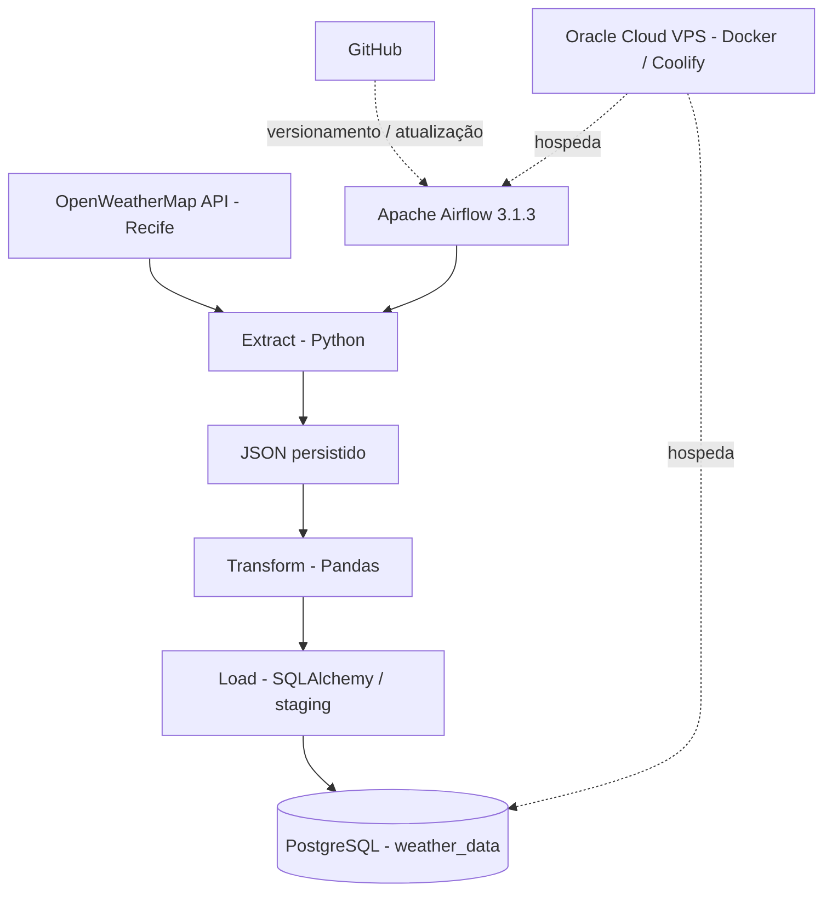

# Relatório Técnico — Weather Data Pipeline

**Versão:** 1.5  
**Data de referência:** 06/11/2026  
**Projeto:** Engenharia de Dados Meteorológicos em Nuvem  
**Repositório:** https://github.com/Robert-FM/weather-data-pipeline  
**Estado:** Relatório técnico revisado com procedimentos conhecidos, critérios de evidência e lacunas identificadas; auditoria do ambiente e reprodução integral ainda pendentes.

> **Nota de rastreabilidade:** Este relatório reúne informações recuperadas das conversas sobre a construção do projeto. Distingue fatos observados, informações ainda não verificadas e melhorias futuras. Não substitui a auditoria do código, dos contêineres ou dos logs. Não inclui senhas, tokens nem chaves privadas.

## Como interpretar este documento

Este documento possui **27 seções do relatório**, **20 capítulos propostos para a documentação futura** e **37 itens do escopo documental**, sendo o item 37 o plano de conclusão. Esses números representam estruturas diferentes e **não são 37 capítulos**.

**Classificação obrigatória das informações:**

- **[CONFIRMADO]**: comando, resultado ou configuração explicitamente observado no histórico disponível.
- **[RECONSTRUÍDO]**: procedimento sugerido com base no estado conhecido, ainda não comprovado como comando original.
- **[A CONFERIR]**: informação incompleta que requer consulta ao código, VPS ou logs.
- **[PLANEJADO]**: funcionalidade, teste ou procedimento ainda não implementado.

**Limite da revisão:** esta versão foi corrigida a partir do relatório v1.4 e do histórico técnico recuperado. Não houve nesta revisão conexão com a VPS nem auditoria independente do repositório. Não interpretar exemplos de comandos como evidência de sua execução.

## 1. Resumo executivo

O Weather Data Pipeline coleta informações meteorológicas de Recife pela API OpenWeatherMap, transforma os dados com Python/Pandas e os persiste no PostgreSQL. O Apache Airflow 3.1.3, executado em contêineres Docker numa VPS Oracle Cloud ARM Ampere A1, agenda a execução do pipeline a cada seis horas. O código é versionado no GitHub. Foi confirmada uma execução agendada com estado `success` em 06/11/2026 às 15h (horário de Brasília), acompanhada da presença de um registro meteorológico recente no PostgreSQL.

**Escopo deste relatório:** arquitetura, ambiente, implantação, dados, erros, correções, testes, segurança, manutenção, riscos, evidências e plano de documentação definitiva.

## 2. Identificação e tecnologias

| Item | Informação |
|---|---|
| Ambiente de desenvolvimento | Windows, VS Code, Python 3.12, uv |
| Projeto local | `C:\Users\rober\OneDrive\Documentos\Workspace\engenharia-dados` |
| GitHub | `Robert-FM/weather-data-pipeline` (`main`) |
| Servidor | Oracle Cloud, Ubuntu, ARM Ampere A1 |
| Diretório na VPS | `/home/ubuntu/weather-data-pipeline` |
| Gerenciamento | Docker e Coolify |
| Orquestração | Apache Airflow 3.1.3, LocalExecutor |
| Banco | PostgreSQL 17 Alpine, `weather_db` |
| Tabela | `weather_data` |
| DAG | `weather_etl_recife` |
| Agendamento | `0 */6 * * *` |

## 3. Arquitetura e fluxo



O agendamento do Airflow ocorre na VPS e não depende de o computador Windows estar ligado. A disponibilidade depende do servidor, dos contêineres, da rede e dos serviços externos utilizados.

## 4. Estrutura de arquivos conhecida

```text
weather-data-pipeline/
├── src/
│   └── engenharia_dados/
│       ├── config.py
│       ├── extract.py
│       ├── transform.py
│       ├── load.py
│       └── pipeline.py
├── weather_etl_dag.py       # localizado na VPS; versionamento a confirmar
├── backups/                 # arquivos locais de backup na VPS
├── .env                     # NÃO versionar
├── .gitignore
└── pyproject.toml
```

- `config.py`: configurações e variáveis de ambiente.
- `extract.py`: consulta da API e geração do JSON.
- `transform.py`: organização e transformação com Pandas.
- `load.py`: persistência PostgreSQL, staging e controle de duplicatas.
- `pipeline.py`: coordenação das etapas ETL.
- `weather_etl_dag.py`: integração do ETL com o Airflow.

**A verificar:** inventário real do repositório, arquivos de lock, dependências, DAG versionada e configurações dos serviços.

## 5. Acesso e operação — comandos conhecidos

### 5.1 Acesso SSH pelo Windows PowerShell

```powershell
ssh -i "$env:USERPROFILE\.ssh\id_ed25519" ubuntu@147.15.87.118
```

### 5.2 Túnel para a interface Airflow

```powershell
ssh -i "$env:USERPROFILE\.ssh\id_ed25519" -N -L 8081:127.0.0.1:8081 ubuntu@147.15.87.118
```

Acessar `http://localhost:8081` enquanto o túnel estiver ativo.

### 5.3 Túnel para PostgreSQL

```powershell
ssh -i "$env:USERPROFILE\.ssh\id_ed25519" -N -L 127.0.0.1:5433:10.0.2.8:5432 ubuntu@147.15.87.118
```

**Segurança:** o IP e os nomes de serviços são referências do ambiente observado; não publicar credenciais ou conteúdo do `.env`. A configuração de exposição de portas ainda precisa de auditoria.

### 5.4 Atualização do código na VPS

```bash
cd ~/weather-data-pipeline
git pull --ff-only origin main
```

Foi confirmado no contêiner do Airflow que o código atualizado continha `ON CONFLICT`. O procedimento de atualização da DAG, copiada separadamente para o volume do Airflow, precisa ser documentado e aprimorado.

### 5.5 Verificação segura do estado dos serviços [RECONSTRUÍDO]

Os comandos abaixo são de **inspeção**, não alteram o estado da VPS e devem ser executados no terminal Ubuntu. São procedimentos recomendados, **não transcrições confirmadas de testes anteriores**:

```bash
sudo docker ps --format 'table {{.Names}}\t{{.Image}}\t{{.Status}}\t{{.Ports}}'
sudo docker volume ls
sudo docker network ls
cd ~/weather-data-pipeline && git status --short && git log -1 --oneline
```

**Resultado esperado:** listar contêineres ativos, volumes e redes, além de indicar a versão local do repositório. **Cuidado:** `docker inspect` e saídas integrais de configuração podem revelar credenciais; não publicar sem sanitização.

### 5.6 Configuração das variáveis de ambiente [CONFIRMADO / A CONFERIR]

No Windows, o acesso ao banco utilizou `POSTGRES_HOST=127.0.0.1` e `POSTGRES_PORT=5433`, por meio de túnel SSH. No ambiente de execução na VPS, o serviço utilizou o hostname Docker `oatx3x3to3726noerkwsuwfn` e a porta interna `5432`. O banco é `weather_db` e o usuário `weather_user`. A chave da OpenWeatherMap e a senha do banco são fornecidas por variáveis de ambiente, **sem registrar seus valores**. A lista integral de variáveis e o conteúdo de `.env.example` ainda precisam ser confrontados com `config.py` e com o ambiente implantado.

## 6. Infraestrutura e persistência

- **Airflow:** contêineres separados para scheduler, DAG processor, API server e banco de metadados.
- **Código no scheduler:** `/opt/airflow/project/src`, com montagem somente leitura a partir do diretório `src` da VPS.
- **PYTHONPATH:** `/opt/airflow/project/src`.
- **JSON persistido:** `/opt/airflow/data/weather_data.json`, em volume persistente.
- **PostgreSQL:** contêiner `oatx3x3to3726noerkwsuwfn`, porta interna 5432, banco `weather_db`, usuário `weather_user`.
- **Rede interna observada:** hostname Docker do PostgreSQL e IP `10.0.2.8`.

**Inventário de serviços conhecido [CONFIRMADO]:**

| Serviço | Nome do contêiner observado | Papel |
|---|---|---|
| Scheduler | `airflow-scheduler-k5eiuc8iwrbuenbxge08qtox` | Agendamento e execução |
| DAG processor | `airflow-dag-processor-k5eiuc8iwrbuenbxge08qtox` | Processamento das DAGs |
| API server | `airflow-api-server-k5eiuc8iwrbuenbxge08qtox` | Interface e API |
| Metadados Airflow | `airflow-db-k5eiuc8iwrbuenbxge08qtox` | Banco de metadados |
| PostgreSQL de dados | `oatx3x3to3726noerkwsuwfn` | Armazenamento meteorológico |

**Configuração conhecida [CONFIRMADO]:** o scheduler possui bind mount somente leitura de `/home/ubuntu/weather-data-pipeline/src` para `/opt/airflow/project/src`; `PYTHONPATH=/opt/airflow/project/src`. O JSON é persistido em `/opt/airflow/data/weather_data.json`. A DAG foi copiada separadamente para o volume do Airflow, não estando comprovado seu versionamento no Git.

**Pendências [A CONFERIR]:** recuperar compose/configuração integral, imagens, redes, volumes, reinicialização, permissões, recursos, política de atualização e procedimento de restauração dos serviços.

## 7. Banco de dados e dicionário preliminar

| Coluna | Tipo observado | Descrição |
|---|---|---|
| `city_id` | BIGINT | Identificador da cidade |
| `city` | TEXT | Cidade |
| `country` | TEXT | País |
| `latitude` | DOUBLE PRECISION | Latitude |
| `longitude` | DOUBLE PRECISION | Longitude |
| `temperature` | DOUBLE PRECISION | Temperatura |
| `feels_like` | DOUBLE PRECISION | Sensação térmica |
| `humidity` | BIGINT | Umidade |
| `pressure` | BIGINT | Pressão |
| `wind_speed` | DOUBLE PRECISION | Velocidade do vento |
| `weather_description` | TEXT | Condição meteorológica |
| `timestamp` | TIMESTAMP (fuso a conferir no catálogo) | Instante associado ao dado |

`city_id` e `timestamp` são obrigatórios. Foi criado índice único composto:

```sql
CREATE UNIQUE INDEX ux_weather_data_city_timestamp
ON weather_data (city_id, timestamp);
```

**Pendente:** conferir DDL exato, tipo e fuso do timestamp, unidades, origem dos campos, regras de nulidade e restrições adicionais.

## 8. Idempotência e carga

A rotina anterior permitiu duplicações e realizava operações de manutenção do esquema durante a carga. Após limpeza e criação do índice único, `load.py` foi alterado para usar staging temporário e inserção protegida por conflito:

```sql
INSERT INTO weather_data (...)
SELECT DISTINCT ON (city_id, timestamp) ...
FROM weather_data_staging
ORDER BY city_id, timestamp
ON CONFLICT (city_id, timestamp) DO NOTHING;
```

O trecho acima é **esquemático**: para o SQL exato, consultar o arquivo `load.py`. O comportamento observado ao reprocessar o mesmo JSON foi **1 registro recebido, 0 inseridos e 1 ignorado**.

## 9. Histórico conhecido de problemas, correções e resultados

**Critério de registro:** cada incidente deve conter `ID`, data/hora (se conhecida), componente, sintoma, mensagem literal do erro, hipótese, tentativa, correção, comando de verificação, evidência e estado. Quando a mensagem original não estiver disponível, marcar **"não recuperada"**; não recriar mensagens plausíveis como se fossem originais.


| Ocorrência | Ação realizada | Evidência / estado |
|---|---|---|
| Duplicação de dados de Recife | Backup, remoção do duplicado e criação de índice único | 4 registros reduzidos a 3 distintos |
| Reprocessamento duplicava ou arriscava duplicar | Staging + `ON CONFLICT DO NOTHING` | 0 novos, 1 ignorado no teste de repetição |
| Manutenção do esquema dentro da carga | Remoção de limpeza e criação de índice a cada execução | Código atualizado |
| Código antigo potencialmente em execução no Airflow | `git pull` na VPS e inspeção dentro do contêiner | Instrução `ON CONFLICT` encontrada |
| Risco de publicar arquivos locais e segredos | Atualização do `.gitignore` | `.env`, caches, dados e backups ignorados |
| Risco de perda de dados na limpeza | Backup PostgreSQL antes da intervenção | `pg_restore --list` reconheceu o arquivo |

**Não recuperado integralmente:** mensagens originais dos erros de instalação, todas as tentativas malsucedidas, cronologia exata de cada comando e configuração inicial do Docker/Airflow. Esses detalhes não devem ser inventados.

### 9.1 Linha do tempo mínima comprovável

1. Implementação do ETL e conexão com PostgreSQL; execução e testes manuais anteriores à alteração da carga.
2. Identificação de quatro registros, com uma duplicação para a mesma cidade e instante.
3. Backup pré-correção, limpeza para três registros e criação de índice único.
4. Teste em tabela separada `weather_data_teste_idempotencia` (a existência atual da tabela precisa ser conferida).
5. Alteração de `load.py` para staging e `ON CONFLICT`; verificação de sintaxe e testes de inserção/reprocessamento.
6. Atualização do GitHub e da VPS; inspeção do código no scheduler.
7. Execução direta do ETL no contêiner, com um registro inserido; reprocessamento com um registro ignorado.
8. Reativação da DAG; execução agendada de 06/11/2026 às 15h (Brasília), com estado `success`; consulta posterior ao banco.

**Não confirmado:** horários exatos de todas as ações anteriores e transcrição completa das tentativas de instalação. Não atribuir datas ou erros adicionais sem evidência.

## 10. Backup e recuperação

Arquivo de backup conhecido:

```text
/home/ubuntu/weather-data-pipeline/backups/weather_data_antes_idempotencia.dump
```

A listagem com `pg_restore --list` reconheceu a estrutura e os dados do arquivo. **Isso não prova uma restauração bem-sucedida.** A restauração em ambiente isolado, a retenção e a automatização de backups permanecem pendentes.

**Verificação não destrutiva do arquivo [RECONSTRUÍDO]:**

```bash
cd ~/weather-data-pipeline
ls -lh backups/weather_data_antes_idempotencia.dump
pg_restore --list backups/weather_data_antes_idempotencia.dump
```

Se `pg_restore` não estiver instalado no host, verificar a versão e executar a inspeção por um ambiente compatível. **Não executar restauração sobre `weather_db`**: primeiro criar um banco isolado, definir plano de rollback e validar integridade e contagem de registros. O comando exato de restauração dependerá do formato e das permissões verificadas na auditoria.


## 11. Testes executados

| Teste | Resultado observado |
|---|---|
| Sintaxe Python de `load.py` | Aprovada |
| Inserção de registro existente | 0 inseridos; 1 ignorado |
| Inserção de registro novo com rollback | Aprovada |
| Índice único e rejeição de duplicados | Aprovados |
| Backup reconhecido por `pg_restore --list` | Aprovado (não restaurado) |
| Código atualizado presente no scheduler | Confirmado |
| Pipeline executado diretamente no scheduler | Sucesso: 1 inserido |
| Reprocessamento do mesmo JSON | Sucesso: 0 inseridos, 1 ignorado |
| Execução agendada do Airflow | `success` |
| Consulta posterior ao PostgreSQL | Novo registro recente identificado |

### 11.1 Execução direta do ETL

```bash
sudo docker exec airflow-scheduler-k5eiuc8iwrbuenbxge08qtox \
python -c "from engenharia_dados.pipeline import run_pipeline; run_pipeline()"
```

Resultado observado: extração, transformação e carga concluídas; **1 registro recebido e inserido**.

### 11.2 Reprocessamento do JSON

```bash
sudo docker exec airflow-scheduler-k5eiuc8iwrbuenbxge08qtox \
python -c "from engenharia_dados.transform import transform_weather_data; from engenharia_dados.load import load_weather_data; df = transform_weather_data(); load_weather_data(df)"
```

Resultado: **1 recebido, 0 inseridos, 1 ignorado**.

### 11.3 Verificação das execuções da DAG

```bash
sudo docker exec airflow-scheduler-k5eiuc8iwrbuenbxge08qtox \
airflow dags list-runs weather_etl_recife
```

Execução agendada observada:

```text
run_id:     scheduled__2026-11-06T18:00:00+00:00
state:      success
start_date: 2026-11-06T18:00:00.119181+00:00
end_date:   2026-11-06T18:00:02.584679+00:00
```

Equivale a **15h no horário de Brasília**, com duração aproximada de **2,47 segundos**.

### 11.4 Verificação dos dados

```bash
sudo docker exec oatx3x3to3726noerkwsuwfn \
psql -U weather_user -d weather_db \
-c "SELECT city, temperature, humidity, timestamp FROM weather_data ORDER BY timestamp DESC LIMIT 5;"
```

Resultado observado:

| Cidade | Temperatura | Umidade | Timestamp retornado |
|---|---:|---:|---|
| Recife | 29.02 | 70 | `2026-11-06 17:58:20+00` |
| Recife | 31.02 | 62 | `2026-11-06 16:27:27+00` |
| Recife | 31.02 | 62 | `2026-11-06 15:42:08+00` |
| Recife | 30.02 | 66 | `2026-11-06 13:11:04+00` |
| Recife | 30.02 | 66 | `2026-11-06 12:37:53+00` |

O registro das 17:58:20 UTC é compatível com a execução das 18:00 UTC; **o log da tarefa ainda deve ser arquivado** para confirmar a contagem de inseridos/ignorados nessa execução específica.

### 11.5 Critérios de aceite técnicos [RECONSTRUÍDO]

- **Extração:** resposta da API validada e JSON salvo no local esperado.
- **Transformação:** colunas esperadas presentes e tipos/valores coerentes.
- **Carga:** registro novo inserido; repetição da mesma entrada não duplica a chave composta.
- **Agendamento:** nova execução `scheduled` com estado `success` e log da tarefa arquivado.
- **Persistência:** consulta SQL confirma o dado esperado e o índice único continua presente.
- **Recuperação:** backup restaurado com sucesso em ambiente isolado (**ainda não atendido**).

### 11.6 Comandos adicionais de diagnóstico [RECONSTRUÍDO]

```bash
# Ubuntu VPS: estado dos contêineres
sudo docker ps -a

# Ubuntu VPS: logs recentes do scheduler
sudo docker logs --tail 100 airflow-scheduler-k5eiuc8iwrbuenbxge08qtox

# Ubuntu VPS: inspeção do esquema da tabela
sudo docker exec oatx3x3to3726noerkwsuwfn \
  psql -U weather_user -d weather_db -c '\d+ weather_data'

# Ubuntu VPS: conferir duplicatas (somente leitura)
sudo docker exec oatx3x3to3726noerkwsuwfn \
  psql -U weather_user -d weather_db \
  -c 'SELECT city_id, timestamp, COUNT(*) FROM weather_data GROUP BY city_id, timestamp HAVING COUNT(*) > 1;'
```

Esses comandos são propostas para a rotina operacional; não foram todos executados no histórico recuperado.

## 12. Segurança

Documentar e auditar: chaves SSH, túneis, permissões, credenciais da API e do banco, `.env.example`, exposição de portas, segregação de acessos, rotação de segredos e resposta a incidentes. Não versionar `.env`, tokens, senhas, dumps contendo dados sensíveis nem chaves privadas.

## 13. Operação, observabilidade e manutenção

Registrar procedimentos para iniciar/parar/reiniciar contêineres, verificar saúde dos serviços, consultar logs, analisar DAGs, confirmar cargas, atualizar o código, fazer rollback, restaurar backups e lidar com indisponibilidade da API, banco ou VPS. Alertas e monitoramento estruturado ainda são melhorias pendentes.

## 14. Custos, capacidade e riscos

Auditar consumo de CPU, memória e armazenamento da VPS, limites do plano Oracle, limites e disponibilidade da OpenWeatherMap, crescimento da tabela, retenção de backups, escalabilidade para outras cidades e portabilidade da solução. Não há medições suficientes para declarar custos reais ou garantias de disponibilidade.

## 15. Evidências

Estrutura proposta:

```text
docs/evidencias/
├── ambiente/
├── docker/
├── airflow/
├── postgresql/
├── testes/
├── erros/
└── execucoes/
```

Cada evidência deverá registrar data, ambiente, comando, resultado, referência ao requisito e remoção de dados sensíveis.

## 16. Matriz de rastreabilidade preliminar

| Requisito | Implementação | Evidência atual | Próxima validação |
|---|---|---|---|
| Extrair clima de Recife | `extract.py` | JSON gerado no teste | Teste automatizado |
| Transformar dados | `transform.py` | Etapa ETL concluída | Validar esquema e nulos |
| Persistir dados | `load.py` | Consulta PostgreSQL | Teste de integração |
| Evitar duplicatas | Índice único e `ON CONFLICT` | Reprocessamento ignorado | Testes concorrentes e casos-limite |
| Executar por agendamento | DAG Airflow | `scheduled ... success` | Arquivar logs e validar recorrência |
| Proteger credenciais | `.gitignore` / ambiente | Regras ajustadas | Auditoria de histórico Git |

### 16.1 Evidência e localização de artefatos

| Evidência | Referência conhecida | Lacuna |
|---|---|---|
| Código atualizado | Commit `15d275b` em `main`, conforme histórico | Confirmar hash remoto atual |
| Backup pré-correção | `backups/weather_data_antes_idempotencia.dump` | Testar restauração |
| Execução automática | `scheduled__2026-11-06T18:00:00+00:00` | Arquivar log específico |
| Idempotência | Saída `0 inseridos, 1 ignorado` | Automatizar teste |
| Banco de dados | Consulta SQL com cinco registros | Verificar schema e timestamp no catálogo |

## 17. Decisões arquiteturais (ADR)

Registrar motivação, alternativas realmente avaliadas, consequências e evidências para Oracle ARM64, Docker/Coolify, Airflow, PostgreSQL, Python/Pandas, idempotência e atualização por Git. Não afirmar que ferramentas alternativas foram avaliadas se não houver registro dessa avaliação.

## 18. Fluxo de desenvolvimento, implantação e rollback

Fluxo conhecido: **Windows → GitHub → `git pull` na VPS → código montado no Airflow**. A DAG foi copiada separadamente para o volume do Airflow. Documentar versão implantada, confirmação no contêiner, reinício quando necessário, rollback e cuidados com compatibilidade ARM64.

## 19. API e tratamento de falhas

Documentar endpoint e parâmetros da OpenWeatherMap, autenticação, unidades, contrato de resposta, códigos HTTP, timeouts, limites de requisições, retentativas e tratamento de JSON ausente/incompleto. Esses cenários não foram todos testados.

## 20. Temporalidade e reprocessamento

Registrar diferença entre timestamps da observação e do agendamento, UTC e Brasília, janela de coleta, atraso da API, política de catchup, retries, reprocessamento manual, falhas parciais e idempotência. Verificar as configurações reais da DAG antes de descrevê-las como implementadas.

## 21. Migrações, desempenho e encerramento

Criar procedimentos futuros para mudanças de esquema sem perda de dados, medição de duração e uso de recursos, teste de capacidade, desativação segura, exportação de dados e reconstrução do ambiente. Não há benchmark nem teste completo de reconstrução registrados.

## 22. Critérios de aceite da documentação

A documentação será considerada concluída quando:

1. Os comandos executados estiverem recuperados ou explicitamente marcados como reconstruídos.
2. Os arquivos e configurações forem conferidos contra o ambiente real.
3. Os bugs tiverem mensagens originais, diagnóstico, correção e evidência, quando disponíveis.
4. Os procedimentos operacionais forem testados em condições controladas.
5. Um backup tiver restauração testada em ambiente isolado.
6. O guia de instalação permitir reconstruir o ambiente sem depender desta conversa.
7. Os segredos tiverem sido removidos de todo material público.
8. A versão publicada estiver associada a um commit e a uma revisão técnica.

## 23. Glossário breve

- **ETL:** extração, transformação e carga de dados.
- **DAG:** definição de fluxo de tarefas no Airflow.
- **Staging:** área intermediária de carga.
- **Idempotência:** reprocessar a mesma entrada sem criar efeitos duplicados indevidos.
- **LocalExecutor:** executor do Airflow para execução local de tarefas no ambiente do Airflow.
- **Rollback:** retorno controlado a estado/versão anterior.
- **CI:** integração contínua, com verificações automatizadas de código.
- **ADR:** registro formal de decisão arquitetural.

## 24. Plano de documentação definitiva — Seção 37

| Etapa | Atividade | Estado |
|---|---|---|
| 1 | Auditar repositório GitHub | Pendente |
| 2 | Auditar VPS Oracle | Pendente |
| 3 | Conferir Docker e Coolify | Pendente |
| 4 | Conferir Airflow e PostgreSQL | Pendente |
| 5 | Recuperar comandos e procedimentos originais | Pendente |
| 6 | Consolidar erros, bugs e soluções | Pendente |
| 7 | Redigir documentação detalhada em Markdown | Pendente |
| 8 | Revisar evidências e segurança | Pendente |
| 9 | Testar reprodução da implantação | Pendente |
| 10 | Publicar no GitHub | Pendente |

## 25. Índice proposto da documentação em 20 capítulos

1. `01-visao-geral.md` — objetivos e escopo.
2. `02-arquitetura.md` — componentes e fluxo.
3. `03-requisitos.md` — hardware, software e dependências.
4. `04-ambiente-windows.md` — Python, uv, VS Code e Git.
5. `05-oracle-cloud.md` — VPS e SSH.
6. `06-docker-coolify.md` — contêineres, redes e volumes.
7. `07-postgresql.md` — banco, esquema e dicionário.
8. `08-pipeline-etl.md` — módulos e lógica ETL.
9. `09-apache-airflow.md` — DAG e agendamento.
10. `10-testes-validacao.md` — verificações e resultados.
11. `11-erros-bugs-solucoes.md` — troubleshooting histórico.
12. `12-seguranca.md` — acessos e segredos.
13. `13-backup-recuperacao.md` — backup e restauração.
14. `14-operacao-manutencao.md` — procedimentos operacionais.
15. `15-monitoramento.md` — logs e alertas.
16. `16-custos-limitacoes.md` — capacidade e riscos.
17. `17-evidencias.md` — rastreabilidade.
18. `18-historico-implantacao.md` — linha do tempo.
19. `19-reproducao-ambiente.md` — reconstrução do zero.
20. `20-evolucao-projeto.md` — testes automáticos, CI e melhorias.

### 25.1 Organização do escopo documental

Os **37 itens** constituem um **checklist temático e de execução** desenvolvido ao longo das revisões; os **20 arquivos** acima constituem o índice de documentação futura; as **27 seções** deste arquivo compõem o relatório consolidado. A numeração dos itens temáticos não deve ser confundida com a numeração de seções. A **Seção 37** mencionada nas versões anteriores é o nome histórico dado ao plano de conclusão, apresentado aqui na seção 24, e não uma seção numerada 37 deste documento.

## 26. Registro de versões do relatório

| Versão | Evolução |
|---|---|
| 1.1 | Levantamento inicial e expansão para segurança, evidências e operação |
| 1.2 | Inclusão de decisões, implantação, dependências, API, reprocessamento e critérios de aceite |
| 1.3 | Inclusão de rastreabilidade, inventário, comandos, diagnóstico, glossário e controle documental |
| 1.4 | Inclusão do plano de auditoria, redação, validação e publicação (item 37 do escopo) |
| 1.5 | Padronização de status de evidência, inventário de serviços, comandos de diagnóstico, cronologia mínima, critérios de aceite e esclarecimento da numeração |

## 27. Conclusão e próximos passos

A infraestrutura básica foi construída e validada por execução agendada bem-sucedida e verificação posterior dos dados. A **estrutura da documentação** está consolidada em **37 itens de planejamento** e **20 capítulos propostos**. A **documentação operacional exaustiva** ainda depende de auditoria e recuperação de evidências. Não se deve confundir planejamento documental com comprovação técnica.

**Próxima ação recomendada:** auditar o repositório e a VPS, coletar configurações e logs sanitizados e preencher os capítulos com procedimentos reproduzíveis, antes de implementar Pytest e GitHub Actions.

**Pendências críticas para a versão 1.6:** (1) inventário real de `docker compose`/Coolify; (2) configuração integral e versionamento da DAG; (3) esquema exato e fuso do `timestamp`; (4) logs da execução agendada; (5) restauração testada; (6) histórico literal dos erros que ainda puder ser recuperado. Nenhuma dessas atividades foi considerada concluída nesta revisão.
